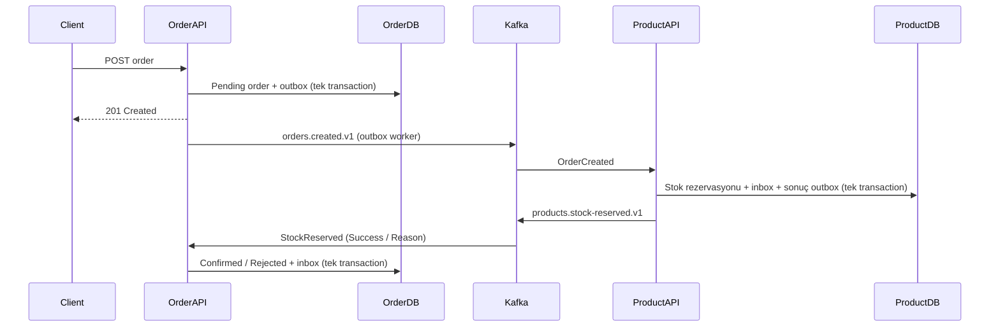

# Kafka ile Product / Order — .NET 10

Controller tabanlı iki bağımsız Web API. EF Core + PostgreSQL, Swagger UI ve gerçek Kafka broker kullanır. Amaç sipariş ve stok üzerinden asenkron iletişimi öğrenmektir.

## Çalıştırma

Docker Engine ve Docker Compose v2 gerekir:

```bash
docker compose up -d --build
```

Yerel makinenizde Product Swagger: `http://localhost:5001/swagger`, Order Swagger: `http://localhost:5002/swagger`.
Bulut onboarding arayüzü localhost web önizlemesi sağlamaz; burada yerel HTTP istekleriyle doğrulama yapılır.

Tam Docker derlemesi Microsoft container registry ve onun bölgesel indirme adreslerine erişim gerektirir. Alternatif: PostgreSQL ve Kafka Docker'da, API'ler host üzerinde:

```bash
# Bulut ortamı (Linux x64): SDK'yı kurar, kilitli restore ve build yapar
bash scripts/install.sh
bash scripts/start.sh
python3 scripts/smoke.py
```

Normal geliştirme makinesinde `global.json` ile belirtilen .NET SDK'yı kurun. `docker compose up -d --wait postgres kafka` ve `docker compose up -d kafka-init` sonrası API'leri IDE'nizde aşağıdaki environment değişkenleriyle başlatabilirsiniz:

| Değişken | Product | Order |
|---|---|---|
| ASPNETCORE_ENVIRONMENT | Development | Development |
| ASPNETCORE_URLS | http://localhost:5001 | http://localhost:5002 |
| Kafka__BootstrapServers | localhost:9092 | localhost:9092 |
| Database__Initialize | true | true |
| ConnectionStrings__Database | Host=localhost;Database=products;Username=app;Password=local-development-only | Host=localhost;Database=orders;Username=app;Password=local-development-only |

`Database__Initialize=true` yalnızca yerel demo içindir: `EnsureCreated` boş veritabanında şemayı oluşturur; mevcut şemayı güncellemez. Model değişikliklerinde veri korumak gerekiyorsa EF migrations ekleyin; EnsureCreated ve migrations akışlarını aynı veritabanında karıştırmayın. Compose ilk açılışta `scripts/init-db.sql` ile iki veritabanını oluşturur. Parola yalnızca yerel geliştirme içindir.

## Swagger ile deneme

1. Product API'de `POST /api/products`:
   ```json
   { "name": "Klavye", "price": 1250, "stock": 5 }
   ```
2. Dönen `id` ile Order API'de `POST /api/orders`:
   ```json
   { "productId": "PRODUCT_ID_BURAYA", "quantity": 2 }
   ```
3. `GET /api/orders/{id}` ile sonucu kontrol edin: önce `Pending`, ardından `Confirmed`.
4. `GET /api/products/{id}`: stok 3 olur. Stoktan fazla miktarla yeni sipariş oluşturun: `Rejected`, stok değişmez.

Her iki controller'da listeleme ve kimlikle getirme uçları da vardır. Sipariş oluşturma cevabı `201 Created` ve `Location` döner; bu, siparişin kaydedildiğini belirtir. Stok onayını beklemez. GET ile son durumu izleyin. Her POST yeni sipariştir; HTTP isteğini yeniden göndermek yeni bir sipariş oluşturur. Kafka inbox koruması HTTP idempotency yerine geçmez.

## Onion / Clean bağımlılıkları

```text
Api -> Application -> Domain
Api -> Infrastructure -> Application
                      -> Domain
                      -> Contracts
```

- **Domain:** Product/Order varlıkları; EF, HTTP veya Kafka bağımlılığı yok.
- **Application:** ProductService / OrderService, doğrulama ve iş kuralları, repository arayüzleri. EF/Kafka bağımlılığı yok.
- **Infrastructure:** repository uygulamaları, DbContext, inbox/outbox tabloları, Kafka producer ve consumer worker'ları.
- **Api:** controller'lar, DI composition root, Swagger ve hata yanıtları.
- **Contracts:** servislerin paylaştığı sürümlenmiş olay sözleşmeleri; domain varlıkları paylaşılmaz.

Tek PostgreSQL container içinde iki ayrı veritabanı vardır. Servisler birbirinin tablolarına erişmez. Öğrenme kolaylığı için yerelde aynı DB kullanıcısını kullanırlar; gerçek dağıtımda servis başına erişimi kısıtlı kullanıcı gerekir.

## Kafka akışı



Buradaki rezervasyon stoktan düşüştür; ödeme veya iptal akışı yoktur. Yetersiz stok ve bulunamayan ürün teknik hata değildir: olumsuz sonuç olayı yayımlanır, sipariş reddedilir.

### Neden bu şekilde?

- **Transactional outbox:** DB kaydı ile olay aynı transaction içinde yazılır. DB başarılı olup broker'a anlık erişilememesi sipariş olayını kaybettirmez. Worker bekleyen satırları tekrar dener.
- **At-least-once:** publish başarılı olduktan sonra outbox işaretlenmeden proses kapanabilir; aynı olay yeniden gönderilebilir. Producer idempotence broker seviyesindeki retry'ları azaltır; DB ile Kafka arasında exactly-once garantisi sağlamaz.
- **Transactional inbox:** EventId primary key ile saklanır. İşlem, inbox ve varsa sonuç outbox aynı transaction'dadır. Yinelenen EventId stoktan tekrar düşmez.
- **Manual commit:** Consumer offset'i ancak DB commit sonrası kaydedilir. DB commit sonrası offset kaydedilemeden çökülürse yeniden teslim inbox ile güvenli karşılanır.
- **Key = OrderId:** aynı siparişin olayları aynı topic içinde aynı partition'a gider. Topic'ler arasında global sıralama yoktur. Farklı siparişler farklı partition'lara dağılır.
- **Gruplar:** `product-service-v1`, `orders.created.v1` tüketir; `order-service-v1`, `products.stock-reserved.v1` tüketir. Bir grupta partition başına tek aktif consumer vardır.
- **Stok güvenliği:** `Stock >= quantity` koşullu atomik SQL UPDATE, farklı siparişlerin paralel işlenmesinde eksi stoku engeller. DB check constraint ikinci korumadır.
- **KRaft:** ZooKeeper kullanılmaz. Topic'ler açıkça, üç partition ile oluşturulur; otomatik topic oluşturma kapalıdır.

## Gözlem ve hata deneyi

```bash
docker compose logs -f kafka
# API'ler Docker'daysa:
docker compose logs -f product-api order-api
# Host akışında loglar artifacts/Product.log ve artifacts/Order.log içindedir.

docker compose exec kafka /opt/kafka/bin/kafka-topics.sh --bootstrap-server localhost:29092 --describe

docker compose exec kafka /opt/kafka/bin/kafka-consumer-groups.sh --bootstrap-server localhost:29092 --group product-service-v1 --describe

docker compose exec postgres psql -U app -d orders -c 'SELECT "Id", "Topic", "PublishedAt" FROM "Outbox";'

docker compose stop kafka
# Swagger'dan sipariş oluşturun: Pending olarak kalır.
docker compose start kafka
# Worker yeniden gönderir; sipariş sonuçlanır.
```

Container'lar `kafka:29092`, host API'ler `localhost:9092` kullanır; advertised listeners ikisini de destekler. Kafka portunu başka bir makineden kullanmak için EXTERNAL advertised listener adresini o makineden erişilebilen adresle ayarlamak gerekir.

## Testler ve sınırlar

`python3 scripts/smoke.py` çalışan sistemde gerçek HTTP, PostgreSQL ve Kafka ile şunları doğrular: Swagger şemaları, sipariş onayı, yetersiz stok, bulunamayan ürün, 400 doğrulaması, aynı olayın tekrar teslimi, eşzamanlı siparişlerde overselling koruması ve Kafka kesilip açıldığında outbox toparlanması. Test yeni örnek kayıtlar ekler; Kafka'yı kısa süre durdurur ve finally bloğunda yeniden başlatır. İzole geliştirme ortamında çalıştırın.

Bu öğrenme kurulumunda servis başına tek outbox dispatcher vardır; aynı servisi birden fazla replica ile çalıştırmadan önce outbox satırları için claim/lease veya PostgreSQL `FOR UPDATE SKIP LOCKED` eklenmelidir. Bir consumer içinde işleme sıralıdır. Teknik hatada mevcut mesaj beklenerek yeniden denenir; sonraki offset'lere atlanmaz. Bozuk/uyumsuz mesaj bu consumer'ın ilerlemesini durdurur ve loglanır. Otomatik DLQ, retry topic veya operatör replay aracı bu örnekte yoktur; sessizce mesaj atılmaz. Uzun hatalarda consumer yeniden dengelenebilir; inbox tekrar işlemeyi güvenli tutar. Inbox/outbox temizleme politikası bu örnekte yoktur.

Tek broker, replication factor 1 ve PLAINTEXT yalnızca yerel öğrenme içindir. Çok brokerlı yüksek erişilebilirlik, TLS/SASL, HTTP yetkilendirme, HTTP idempotency, ödeme, timeout/compensation saga ve operasyonel izleme bu örneğin kapsamı dışındadır. `Acks.All` tek replikalı kurulumda fiziksel replika yedekliliği sağlamaz. Kafka ve PostgreSQL verileri named volume'lerde tutulur; `docker compose down` veriyi korur, `docker compose down -v` siler.
